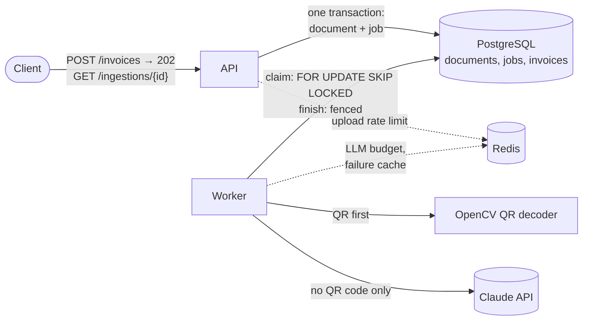

# Swiss QR-bill API

REST API that turns Swiss PDF invoices into validated payment data.

[](https://github.com/flcnv/swissqr/actions/workflows/ci.yml)

An upload is accepted with `202` and queued. A background worker decodes the Swiss QR Code,
validates the payment data against the SIX Implementation Guidelines QR-bill v2.4 and stores it
in PostgreSQL. If the document has no QR code, Claude extracts the same fields from its text,
and that output goes through the same validation as a scanned code.

Python 3.15, FastAPI, SQLAlchemy 2 (async), PostgreSQL 18, Redis 8, OpenCV, pypdfium2, Anthropic SDK.

## Quick start

Requires Docker; the demo uses `curl` and `jq`.

```bash
cp .env.example .env      # set ANTHROPIC_API_KEY to enable the LLM fallback (optional)
docker compose up --build # migrations, then the API (localhost:8000) and the worker
```

In a second terminal, from the repository root:

```bash
UPLOAD=$(curl -s -F "file=@tests/fixtures/invoice_with_qr.pdf;type=application/pdf" http://localhost:8000/invoices)
echo "$UPLOAD" | jq
INGESTION=$(echo "$UPLOAD" | jq -r .id)

sleep 2   # the upload's Retry-After
curl -s http://localhost:8000/ingestions/$INGESTION | jq

INVOICE=$(curl -s http://localhost:8000/ingestions/$INGESTION | jq -r .invoice_id)
curl -s http://localhost:8000/invoices/$INVOICE | jq
```

The upload (`202 Accepted`, `Location: /ingestions/{id}`), then the same ingestion once the worker is done:

```json
{"id": "ceb85698-8d4b-4f7b-bc47-afbacef5cc4e", "status": "pending", "attempts": 0, "invoice_id": null, "error": null, "created_at": "2026-11-24T20:32:27.626133Z", "updated_at": "2026-11-24T20:32:27.626133Z"}
{"id": "ceb85698-8d4b-4f7b-bc47-afbacef5cc4e", "status": "done", "attempts": 1, "invoice_id": "7b664bc7-1dc1-4580-a665-8875e3b69228", "error": null, "created_at": "2026-11-24T20:32:27.626133Z", "updated_at": "2026-11-24T20:32:28.561019Z"}
```

The invoice:

```json
{
  "id": "7b664bc7-1dc1-4580-a665-8875e3b69228",
  "created_at": "2026-11-24T20:32:28.378608Z",
  "source": "qr",
  "is_notification": false,
  "creditor": {"iban": "CH6431961000004421557", "name": "Max Muster & Söhne",
               "address": {"street": "Musterstrasse", "building_number": "123", "postal_code": "8000", "town": "Seldwyla", "country": "CH"}},
  "amount": {"value": "50.00", "currency": "CHF"},
  "debtor": {"name": "Simon Muster",
             "address": {"street": "Musterstrasse", "building_number": "1", "postal_code": "8000", "town": "Seldwyla", "country": "CH"}},
  "reference": {"type": "QRR", "value": "000008207791225857421286694"},
  "unstructured_message": "Bezahlung der Reise",
  "billing_information": null,
  "alternative_procedures": [],
  "warnings": []
}
```

Amounts are strings: money is a `Decimal` end to end, never a float. Without an API key,
`tests/fixtures/invoice_without_qr.pdf` fails with `llm_fallback_not_configured`. OpenAPI docs:
`http://localhost:8000/docs`. Local development without Docker for the app: `make help`.

## How it works



API and worker are two processes from one image. The code is hexagonal: a pure-Python domain
(payload parsing, validation, duplicate rules), use cases that depend only on ports (Protocols),
and adapters for PostgreSQL, Redis, OpenCV, pypdfium2 and Claude.

**Job lifecycle:** `pending → processing → done | failed`. A transient failure (LLM timeout or
5xx, database or Redis unreachable) goes back to `pending` with exponential backoff and jitter,
up to `JOB_MAX_ATTEMPTS`; anything else fails at once. On SIGTERM, a worker stops claiming, lets
in-flight jobs finish for `WORKER_SHUTDOWN_TIMEOUT_SECONDS`, then releases the rest to `pending`
with their attempt given back. Uploading a `failed` file again requeues it.

**Parser strategy:** PDF pages are rendered at 300 dpi and scanned for the Swiss QR Code. Claude
is called only when there is **no QR code at all**: a code that is present but invalid fails the
job, it is not a reason to let a model guess. A document with neither a QR code nor a text layer
fails as `unreadable_document` without an LLM call. Both paths end in the same `ensure_valid`.

**Bounded work per upload:** the body is cut off while it is received once it passes
`MAX_UPLOAD_MB` (plus a small multipart allowance), so an oversized upload is never read in full.
A PDF with more than `MAX_PDF_PAGES` pages is not rejected: its first pages and its last page (where
the payment part usually is) are read, the rest is ignored. A page that would have more than
`MAX_PDF_PAGE_PIXELS` at 300 dpi (any page larger than A3, or a forged huge MediaBox) is rendered
at a lower dpi instead. The text sent to Claude is truncated.

## Design decisions and trade-offs

- **Job queue in PostgreSQL, not Celery or arq.** The document and its job are stored in one
  transaction, so there is no dual write and no outbox: a job can't exist without its document,
  or the other way round. `FOR UPDATE SKIP LOCKED` gives each job to exactly one worker. A
  broker becomes worth it with many job types or much higher throughput.
- **Leases and fencing.** A claim sets a lease longer than the slowest possible job (derived from
  the LLM timeout and retries). A dead worker's job is reclaimed when the lease expires. Every
  change out of `processing` applies only `WHERE locked_by = <this worker>`, so a worker that
  lost its lease can't overwrite the new owner's result. Marking the job `done` and inserting the
  invoice is one transaction. Scheduling uses the database clock, not the workers' clocks.
- **Idempotency by file hash, duplicates by business key.** A unique SHA-256 per job means the
  same file is never processed twice, even when uploaded concurrently. The same bill in a
  *different* file (a rescan) is stored with a `possible_duplicate` warning and the matching
  invoice ids, never rejected: a second copy can be legitimate, so the decision belongs to
  whoever releases payments. See [what is guaranteed](#duplicate-uploads-what-is-guaranteed).
- **Fail open, fail closed.** If Redis is down, the upload rate limit and the LLM failure cache
  fail open (logged): losing them briefly costs nothing, and QR jobs keep working. The LLM budget
  fails closed: jobs that need Claude retry later, because an unchecked budget is the risk it
  exists for.
- **LLM output is untrusted.** Claude gets only the document text (truncated, marked as data, not
  instructions) and returns schema-constrained JSON. That JSON goes through the same domain
  validation as a QR payload, so a misread IBAN digit fails mod 97. An answer that is unusable
  or fails validation is cached per file, keyed by build and request config, so a known-bad file
  doesn't spend budget again.
- **Only known-transient errors are retried.** The list is explicit. An unknown exception is
  most likely a bug, and retrying it after Claude answered would pay for the same call again, so
  it fails at once as `internal_error`.
- **One composition root.** `src/bootstrap.py` is the only place that creates clients and
  adapters, for both processes. Services receive the ports they need, never the container; an
  architecture test enforces which modules may import it.
- **OpenCV, not zbar.** zbar missed codes with the Swiss cross and re-decoded UTF-8 with a
  guessed charset (`Söhne` came back as Big5). OpenCV decoded every fixture, including the densest
  possible code.

### Duplicate uploads: what is guaranteed

| Situation | Result |
|---|---|
| Same file, already `done` | `200` + its ingestion; not processed again |
| Same file while `pending` or `processing` (even at the same moment) | `202` + the same ingestion |
| Same file after it `failed` | queued again (`202`); a remembered LLM failure is replayed without a call |
| Same bill, different file | a new invoice with a `possible_duplicate` warning (`QRR`/`SCOR` only) |

At most one job per file and one invoice per job, enforced by database constraints, not by Redis.

## Swiss QR-bill rules implemented

Chapter numbers refer to the
[SIX Implementation Guidelines QR-bill v2.4](https://www.six-group.com/en/products-services/banking-services/payment-standardization/standards/qr-bill.html).
The specification PDFs are not in this repository (copyright); the test fixtures for its Annex A
examples are transcribed by hand.

| Rule | Chapter |
|---|---|
| Payload: UTF-8, allowed character set, max 997 characters, CRLF or LF (not mixed), `SPC` / `0200` / `1` header, `EPD` trailer | 4.1, 4.2.2 |
| Field lengths, structured addresses (type `S`), ISO 3166 country codes, empty ultimate creditor | 4.2.2 |
| IBAN: 21 characters, `CH` or `LI`, mod 97 check | 4.2.2 |
| QR-IBAN: institution ID (positions 5–9) in 30000–31999 | 2.8 |
| QR reference (`QRR`): 27 digits, not all zeros, mod 10 recursive check digit | 2.12.1, Annex B |
| Creditor reference (`SCOR`): ISO 11649, `RF` + mod 97, 5–25 characters, case-insensitive | 2.12.2 |
| Combinations: QR-IBAN only with `QRR`; regular IBAN only with `SCOR` or `NON` (empty reference) | 4.3.2, 7.1 |
| `QRR` in EUR: allowed by v2.3 until November 2027, accepted with a `eur_qr_reference_deprecated` warning | 4.3.2 |
| Amount: empty or `0.01`–`999999999.99`, two decimals | 4.2.2 |
| Notification ("DO NOT USE FOR PAYMENT"): amount `0.00` + one of the fixed texts, `is_notification: true` | 4.4 |
| Message at most 140 characters; with billing information, together at most 140 (excess is a warning) | 4.3.3 |
| Errors in optional status A lines (billing information, alternative procedures) are warnings, not rejections | 4.2.1 |

## API

| Method | Path | Result |
|---|---|---|
| `POST` | `/invoices` | Multipart `file`: `application/pdf` only, at most `MAX_UPLOAD_MB` (default 5 MB), must start with `%PDF-`. `202` + ingestion, `Location`, `Retry-After: 2`; `200` if the same file is already `done` |
| `GET` | `/ingestions/{id}` | `status`, `attempts`, `invoice_id` once `done`, `error` once `failed` |
| `GET` | `/invoices/{id}` | The invoice |
| `GET` | `/invoices?creditor_iban=&currency=&limit=&offset=` | `{items, total, limit, offset}`, newest first, `limit` 1–100 |
| `GET` | `/health` | `{"status": "ok", "version": "<git sha>"}` |

Every error has the shape `{"error": {"code", "message", "details": [...]}}`, and so does a failed
ingestion's `error` (one `details` entry per violated rule). Every response carries `X-Request-ID`.

| Request refused | Ingestion failed (`error.code`) |
|---|---|
| `400 unreadable_document`: empty file, or content isn't a PDF | `unreadable_document`: corrupt file, or no QR code and no text |
| `404 invoice_not_found`, `ingestion_not_found` | `invalid_qr_payload`: QR code found, text breaks the payload format |
| `413 file_too_large`: file over `MAX_UPLOAD_MB` | `invalid_invoice`: breaks a validation rule |
| `415 unsupported_media_type`: not `application/pdf` | `extraction_failed`: Claude's answer was unusable |
| `422 request_validation` | `llm_fallback_not_configured`: no QR code and no `ANTHROPIC_API_KEY` |
| `429 rate_limited` (with `Retry-After`) | `llm_quota_exceeded`: no QR code and the LLM budget is used up |
| `500 internal_error` | `retries_exhausted`: a transient problem outlasted every attempt |
| `503 storage_unavailable` (with `Retry-After`): the database is unreachable | `internal_error`: a bug; details only in the worker log |

## Operations

All settings come from environment variables or `.env`; [.env.example](.env.example) lists them.

| Variable | Default | Purpose |
|---|---|---|
| `POSTGRES_*`, `REDIS_*` | `localhost`, standard ports | Connections |
| `ANTHROPIC_API_KEY`, `ANTHROPIC_MODEL` | unset, `claude-sonnet-5-5` | LLM fallback (worker only) |
| `LLM_TIMEOUT_SECONDS`, `LLM_MAX_RETRIES` | `60`, `2` | Per Claude request; also size the job lease |
| `MAX_UPLOAD_MB` | `5` | Largest accepted PDF; enforced while the body is received |
| `MAX_PDF_PAGES` | `10` | Pages read per PDF: the first ones and always the last; the rest is ignored |
| `MAX_PDF_PAGE_PIXELS` | `25000000` | Pixels per rendered page; larger pages are rendered at a lower dpi |
| `UPLOADS_PER_CLIENT_PER_MINUTE` | `20` | Upload limit per client IP |
| `LLM_REQUESTS_PER_CLIENT_PER_HOUR`, `LLM_REQUESTS_PER_DAY` | `10`, `200` | LLM budget per client and in total |
| `LLM_FAILURE_CACHE_TTL_SECONDS` | `86400` | How long an unusable LLM result is remembered |
| `WORKER_CONCURRENCY`, `WORKER_POLL_INTERVAL_SECONDS` | `2`, `1` | Jobs per worker, idle polling interval |
| `WORKER_SHUTDOWN_TIMEOUT_SECONDS` | `30` | Grace period for in-flight jobs on SIGTERM |
| `JOB_MAX_ATTEMPTS`, `JOB_RETRY_BASE_SECONDS`, `JOB_RETRY_CAP_SECONDS` | `5`, `2`, `300` | Retries and backoff |
| `JOB_LEASE_MARGIN_SECONDS` | `150` | Lease = LLM timeout × (retries + 1) + margin |
| `LOG_LEVEL`, `LOG_FORMAT` | `INFO`, `text` | `json` for production |
| `GIT_SHA` | `dev` | Build version, set at image build; shown by `/health` and in logs |

**Logging.** With `LOG_FORMAT=json`, every line is one JSON object with `version`, `request_id` and,
in the worker, `job_id`; the upload's request ID is carried into the worker's lines for its job.
Logs contain ids, counts, codes and error types, never IBANs, names, document contents or query
strings. uvicorn's access log is disabled (`--no-access-log`) because it writes full URLs, and
`?creditor_iban=` carries an IBAN. The app writes its own access line instead: method, route
template, status, duration. `GET /health` is logged at DEBUG so the Docker healthcheck doesn't
flood the log. The database engine hides SQL parameters, so a failing query can't put row values
into a log.

**Behind a load balancer.** Limits are per client IP, so uvicorn must trust `X-Forwarded-For`
from the balancer only: set `FORWARDED_ALLOW_IPS` to its addresses or subnet, never `*` (the app
warns at startup if it is). Unset, every client shares the balancer's IP and one limit. Let the
proxy or load balancer also enforce a request body limit (a little above `MAX_UPLOAD_MB`, e.g.
nginx `client_max_body_size 6m`): the app stops reading an oversized body, but rejecting it in front
of the app keeps it from tying up a connection and a worker process at all. If ALB
access logs are ever enabled, they record full URLs including query strings: keep them off or
treat the bucket as holding personal data.

## Testing and CI

```bash
make test-unit   # domain, use cases and API with in-memory fakes; no I/O
make test        # everything; needs PostgreSQL and Redis (make infra-up)
make check       # what CI's first job runs: ruff, format check, mypy --strict, pytest
```

- **Unit:** every spec rule with valid and invalid cases, starting from the specification's own
  Annex A examples; the API with in-memory fakes behind every port.
- **Integration:** a separate, freshly migrated PostgreSQL database and real Redis. The queue is
  tested where its guarantees live: 20 concurrent claims over 10 jobs, lease expiry, a stale
  worker's rejected completion, backoff, `retries_exhausted`, poison jobs, graceful shutdown, and
  upload to invoice end to end on generated PDF fixtures (plus page images for the QR decoder alone)
  ([`scripts/generate_qr_fixtures.py`](scripts/generate_qr_fixtures.py)).
- **No real LLM calls:** the Claude adapter runs a real `AsyncAnthropic` client against an
  in-process stub transport.

[CI](.github/workflows/ci.yml) runs ruff, mypy and the full suite against PostgreSQL and Redis
services, applies all migrations to an empty database and fails if `alembic check` finds a
difference to the models, builds the Docker image, starts the full stack and runs
[`scripts/smoke_test.py`](scripts/smoke_test.py) (upload a QR-bill, wait for the invoice).

## Limitations and next steps

- **No authentication or multi-tenancy.** Anyone who can reach the API can upload and read all invoices.
- **Documents are stored in PostgreSQL.** Fine at this scale; they sit behind a `DocumentStorage`
  port, so an object store can replace it without touching the use cases.
- **Workers poll** (every second when idle) instead of waking on `LISTEN/NOTIFY`.
- **No retention policy.** Documents and the uploader IPs stored on jobs are kept indefinitely.
- **The LLM fallback is not evaluated.** Tests cover its control flow with a stubbed client and
  synthetic fixtures. It was checked end to end against the real API on a few sample PDFs;
  extraction quality on real-world invoices has not been measured.
- **No OCR.** A scanned PDF without a QR code and without a text layer fails as unreadable.
- **Jobs blocked by the LLM budget fail** (`llm_quota_exceeded`) instead of waiting for it to reset.
- **Rate limits are fixed windows**, so a burst at a window boundary can reach twice the limit.

## License

[MIT](LICENSE)
